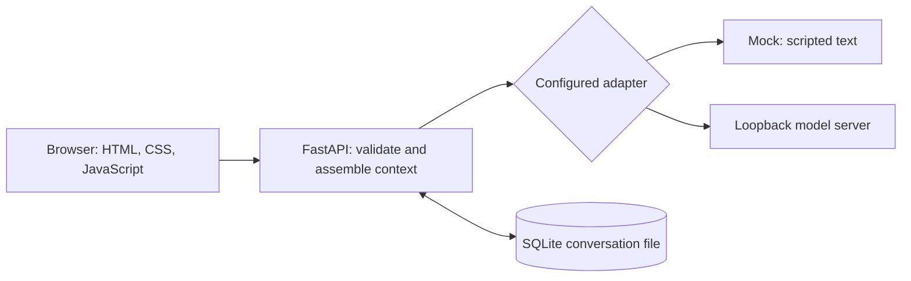

# How the foundation fits together

## The short version

The browser presents the conversation. The Python application decides what to send,
calls a replaceable inference adapter, and saves the successful exchange. The model
server is a separate process. SQLite is a file containing the conversation tables.

## Decisions made for milestone 01

| Decision                                 | Reason                                                                    | Cost / when to reconsider                                                        |
| ---------------------------------------- | ------------------------------------------------------------------------- | -------------------------------------------------------------------------------- |
| Python + FastAPI                         | Typed request validation and a familiar path into Python training tools   | Adds a server process; revisit if deployment needs change                        |
| Plain HTML/CSS/JS                        | No frontend framework or build pipeline to learn before tracing a message | Manual UI state updates; reconsider when interface complexity warrants it        |
| SQLite via Python's standard library     | Inspectable local storage without installing a database service           | Add explicit migrations before changing schema; not a multi-user database design |
| An adapter with `status` and `complete`  | Keeps backend-specific behavior out of routes and UI                      | Only the initial API subset is supported                                         |
| Mock by explicit configuration           | Development can proceed before hardware or model setup                    | Scripted replies prove application behavior, never model capability              |
| Character and backend snapshots per chat | Reopening a chat does not silently change its prompt or mix backends      | Edit configuration and begin a new conversation to use changes                   |
| Plain text, complete replies             | Easier error handling and safe rendering with `textContent`               | No rich Markdown or token streaming yet                                          |
| One process / one generation             | Matches a single local GPU and deterministic history order                | Additional sends receive a clear “busy” response; no task queue                  |
| uv + lockfile                            | Reproducible dependency installs on Windows and Linux                     | Updating dependencies is a deliberate `uv lock --upgrade` change                 |

These are starting choices, not permanent commitments. None chooses a model family,
final character, training framework, or research hypothesis.

## Second increment: real profiles, visuals, and bounded tools

`config/profiles.json` defines the three provisional characters. `Settings.for_profile`
resolves optional per-character endpoint/model/key overrides on the server, and
`create_app` creates the corresponding backend adapters. A conversation stores its
profile inside the existing character snapshot, so no destructive schema migration
was required. Old conversations keep their original draft profile. Identity checks
prevent continuing a chat after its configured backend/model/adapter label changes.

The browser applies a theme based on the selected or snapshotted character. Shared
`characters.css` supplies the geometric shapes and motion used in chat and the
separate visual studio. Pose and theme changes are presentation state, independent
of endpoint readiness, trained weights, or operating-system window control.

The selected replacement visual baseline is **E**, recorded in
[`research/visual-studies/baseline.json`](../research/visual-studies/baseline.json).
Its reference sheet establishes distinct silhouettes and separate palettes.
The new `/static/e-preview/index.html` proof is independent of the ordinary chat
artwork. Shared presentation components load bundled SVG pose parts, reject stale
asset responses, cancel superseded motif transitions, and position an input-transparent
agent cursor by its hotspot. No API or database schema changed. The hosted copy is
static and contains no chat data or backend configuration. E proofs await visual
review; native cursors, model lifecycle, audio, and autonomous jobs remain separate.

`ToolRunner` provides read-only project text and optional Brave search. An explicit
inspector calls it directly. For model-assisted tools, `complete_with_tools` sends
only the definitions enabled for that message, validates the requested names and
arguments, executes at most three calls, and requests a final reply. Actual results
and usage counts are retained in reply provenance. This adds no shell or computer
control. See `tools.md` for boundaries and the partial-failure limitation.

## One successful exchange

1. `app.js` prevents the browser's normal form submission, reads the draft, and
   creates a conversation if needed.
2. `POST /api/conversations/{id}/messages` validates the message and checks that the
   conversation belongs to the configured backend, endpoint, and model.
3. `context_for` assembles the snapshotted system prompt, recent complete exchanges,
   and the new user message, subject to pair and character limits.
4. The selected adapter returns text and source information. For real inference it
   calls `POST /v1/chat/completions`; for mock it constructs an explicitly labeled
   fixed reply. No route executes model-generated tools.
5. `append_exchange` inserts the user and assistant rows in one database transaction.
   They either both commit or neither does.
6. The API returns the stored conversation. The UI renders text, clears the draft,
   refreshes the session list, and offers provenance details on each assistant reply.

If inference fails, there is no successful pair to store: the draft stays in the
browser and the transcript remains unchanged. A newly created empty conversation
may remain and can be retried or deleted. Reloading the page can lose an unsent draft.

## Source records and limits

Each assistant row records backend, configured endpoint, requested and reported model
IDs, elapsed request time, selected numeric usage counts, omitted history count,
and cloud/locality declarations. A reported ID is the server's claim, not proof of
weight identity. Reproducible experiments will additionally need artifact hashes,
adapter IDs, quantization, chat template, sampling settings, and exact server versions.

Browser requests are same-origin. Mutations with another Origin are rejected, and
Host headers are restricted to local names. Backend URLs must be loopback addresses;
redirects and environment HTTP proxies are disabled for those local calls. Secrets
stay in server-side configuration. These are boundaries for a local prototype,
not a replacement for authentication if public serving is added later.

## Extension points, not features already implemented

- **Memory:** separate user-inspectable facts from raw transcripts; include source,
  timestamp, correction, deletion, and consent controls. Log exactly what was retrieved.
- **Tools beyond the first read/search tools:** extend typed requests, supported
  service APIs, permissions, results, and citations. Tool text must remain
  distinguishable from model guesses.
- **Calendar:** Google Calendar with Canvas synced into it is the deadline source of
  truth. A future read-only connector should expose freshness and sync failures.
- **Frontier assistance:** a separate explicit provider adapter, supported API and
  billing model, visible limits, consent about shared data, usage accounting, and
  result provenance. A subscription does not automatically include API credits.
- **Model lifecycle:** a backend capability interface for load/unload, actual memory
  measurements, and user-visible switching. Today this is managed manually outside BFI.
- **Training:** offline experiment scripts and versioned artifacts, isolated from chat
  serving. Curated updates can develop character over time; conversations do not
  immediately change weights.

Do not build all of these at once. Prefer one useful, verifiable change at a time.

## Pose fidelity correction

The first E approximation was rejected. The preview now consumes a per-character
catalog of 18 generated-reference poses and directly traced SVGs. Source crops and
palette-normalized references remain available beside each vector. Selection still
uses the actor generation guard; `explaining` remains a compatibility alias for the
role-specific explanation/report/debugging pose. `poseForActivity` supplies visual
mappings without introducing tools or agent execution. Dense pixel-boundary paths
prioritize source fidelity; semantic rigging remains separate. The new motif module
uses cancellable WAAPI choreography instead of the initial CSS slide layers.
