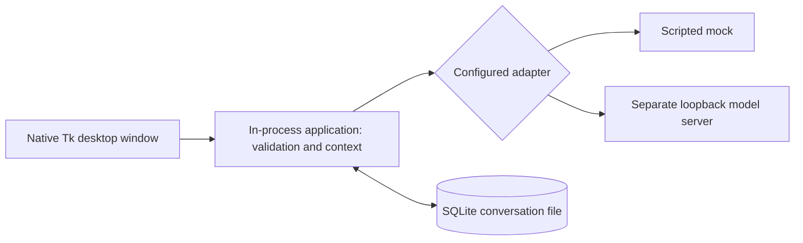

# How the foundation fits together

The primary interface is a standalone desktop application. The Tk window sends
requests to the existing FastAPI application **in process**, using an HTTPX ASGI
transport. No web server or listening port is started by BFI. A separate model
server is still required for real inference and is contacted over its configured
loopback endpoint. SQLite stores conversations locally.

## Decisions

| Decision | Reason and tradeoff |
| --- | --- |
| Standalone Tk desktop | Meets the desktop requirement using Python's GUI toolkit. The initial interface is functional, not a packaged or visually polished product. |
| In-process FastAPI and HTTPX | Preserves tested validation and application behavior without opening a server port. The internal request boundary can be simplified later. |
| Worker thread for requests | Keeps the window responsive while inference runs. One operation at a time keeps conversation order predictable. |
| SQLite | Inspectable local history without a database service; explicit migrations will be needed for schema changes. |
| Separate model adapter | Mock is explicitly labeled; the real adapter calls a separately managed local endpoint and never silently falls back. |
| Character and backend snapshots | Existing conversations preserve their character and cannot mix different backend configurations. |
| Plain text, complete replies | Clear rendering and error handling; streaming is not implemented. |
| uv and lockfile | Reproducible dependency installs; updates are deliberate. |

## One exchange

1. `DesktopApp.send` reads the draft and runs the request in a worker thread.
2. The internal message route validates it, checks the saved backend identity, and
   uses `context_for` to select complete recent exchanges.
3. The adapter returns a scripted mock reply or calls the configured model server.
4. `Store.append_exchange` commits both messages together, then the desktop renders
   the saved conversation and source metadata. On failure the draft is retained;
   creating a new conversation before a failed request can leave an empty record.

The reply source records backend, endpoint, requested and reported model IDs,
elapsed time, token counts when supplied, and omitted history. A server-reported
ID is not proof of the exact weights. Exported history includes private text.

## Extension points, not implemented features

- **Memory:** inspectable facts with sources, correction, deletion, and retrieval records.
- **Tools:** typed requests, permissions, actual results, failure handling, and citations.
- **Calendar:** a future read-only connector should report freshness and sync failures.
- **Frontier assistance:** explicit provider, consent, usage accounting, and provenance.
- **Model lifecycle:** load/unload capabilities and measured memory use.
- **Training:** reproducible offline experiments and evaluation against the unmodified
  starting checkpoint; conversations do not automatically change weights.
