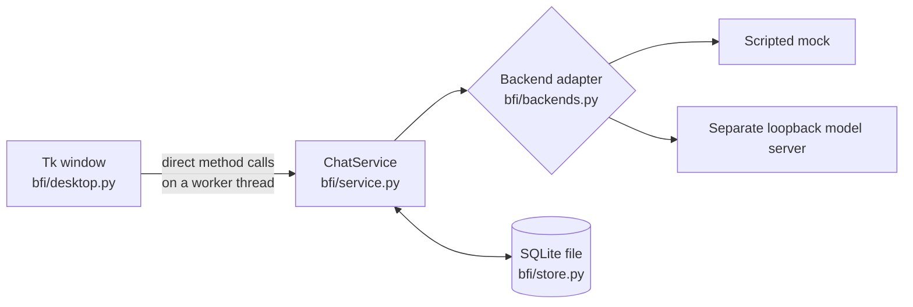

# How the foundation fits together

The app is one Python process with three layers. The **window** shows things and
forwards clicks. The **service** holds every rule about conversations. The **store**
and the **backend adapter** are the only parts that touch the disk and the model.
There is no web server, HTTP layer, or browser inside the app. A separate model
server is needed for real inference and is contacted over its loopback address.

## Decisions

| Decision | Reason and tradeoff |
| --- | --- |
| Standalone Tk desktop window | Meets the desktop requirement with the toolkit that ships with Python. Functional, not polished. Whether to move to Qt is an open owner decision; see the [roadmap](roadmap.md#decisions-waiting-on-the-owner). |
| Plain `ChatService`, no HTTP inside the app (November 12, 2026) | The desktop conversion first kept the old FastAPI app and called it through an in-process HTTP transport. With no browser, that layer only added indirection, a web-framework dependency, and browser security headers nobody received. The window now calls ordinary methods, which also makes streaming and cancellation straightforward to add. An HTTP API can be put back on top of the service if a second client is ever wanted. |
| One worker thread at a time; results return through a queue | Tk is not thread-safe, so widgets are touched only on the main thread. The worker never calls a widget; `poll` collects its outcome every 50 ms. One task at a time keeps conversation order predictable. |
| Blocking (synchronous) code throughout | With one worker thread there is nothing for `asyncio` to coordinate. Blocking calls are easier to read and debug. |
| A conversation is saved together with its first exchange | Creating the row first meant every failed first message left an empty conversation. `Store.start` now writes the row and both messages in one transaction, or nothing. |
| Only complete exchanges are saved | A failed or abandoned reply leaves the database unchanged, so the transcript never holds a question without its answer. The cost: closing mid-reply discards the sent message, so the window asks first. |
| The draft is cleared only after a successful send | Typing is never lost to an error, to switching conversations, or to starting a new one. |
| SQLite, one connection per operation | Inspectable local history with no database service, and safe to call from any thread. The file carries a format version; a file from a newer app version is refused rather than guessed at. Schema changes will need explicit migrations. |
| Separate model adapter | Mock is explicitly labeled; the real adapter calls a separately managed local endpoint and never silently falls back. |
| Character and backend snapshots | Existing conversations keep their character and cannot continue on a different backend or model, which keeps mock text out of real model context. |
| `AppError` for expected failures | Its message is written for the user and shown as-is. Anything else is a bug: the window says so and prints the traceback to the terminal. |
| Plain text, complete replies | Clear rendering and error handling; streaming is the next task. |
| uv and lockfile | Reproducible dependency installs; updates are deliberate. |

## One exchange

1. `DesktopApp.send` reads the draft and hands `service.send(cid, content)` to
   `run_task`, which runs it on a worker thread and disables the controls.
2. `ChatService.send` validates the message, takes the one-generation lock, loads the
   conversation (or prepares an unsaved one when `cid` is `None`), checks the saved
   backend identity, and uses `context_for` to select complete recent exchanges.
3. The adapter returns a scripted mock reply or calls the configured model server.
4. `Store.start` or `Store.append_exchange` commits both messages together.
5. The worker puts the result on a queue. `DesktopApp.poll` picks it up on the main
   thread; `finish` re-enables the controls and either renders the saved conversation
   and clears the draft, or shows the error and leaves the draft alone.

The reply source records backend, endpoint, requested and reported model IDs,
elapsed time, token counts when supplied, and omitted history. A server-reported
ID is not proof of the exact weights. Exported history includes private text.

## Extension points, not implemented features

Ordered work is in [tasks.md](tasks.md); the reasoning is in [roadmap.md](roadmap.md).

- **Streaming and Stop:** `Backend` gains a `stream` method; the service passes
  `on_delta` and `should_stop` through.
- **Tools:** typed requests, an allow-list per message, actual results recorded in
  provenance, failure handling.
- **Memory:** inspectable facts with sources, correction, deletion, and retrieval records.
- **Calendar:** a future read-only connector should report freshness and sync failures.
- **Frontier assistance:** explicit provider, consent, usage accounting, and provenance.
- **Model lifecycle:** load/unload capabilities and measured memory use.
- **Training:** reproducible offline experiments and evaluation against the unmodified
  starting checkpoint; conversations do not automatically change weights.
