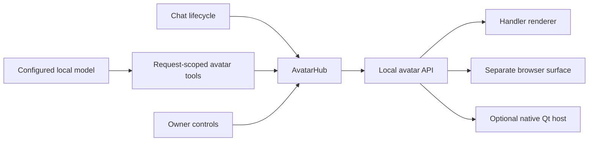

# The handler and the on-screen avatar

The application now uses the E artwork in actual chat. One presentation hub keeps
the active avatar synchronized between the handler, a separate browser surface,
and the optional native overlay. The handler changes its colors to match Academic,
Hacker, or Business. This is presentation code; prompts, model weights, serving,
training, and tool permissions remain separate.

## Run it locally

Start the normal app from the repository root:

```sh
uv sync --locked
uv run --locked python -m bfi
```

Open `http://127.0.0.1:8000`. Mock replies are still explicitly scripted. Choose a
character, try a pose, and send a message. Thinking/reply cues work in mock mode
without pretending that a model made a tool call. Actual model-directed poses need
a compatible endpoint and **Model avatar poses** enabled by the composer. Turn it
off if the endpoint does not support function tools.

**Open separate avatar window** opens `/overlay`, which follows the same live hub.
A browser tab is not an OS overlay. To put it above other desktop applications,
use the optional native host in a second terminal while BFI remains running:

```sh
uv sync --locked --group desktop
uv run --locked --group desktop python -m bfi.desktop
```

The host requests a transparent frameless always-on-top window, loads the local
avatar surface, and follows dock/size updates. Drag its small top handle. Right-click
the handle or use the tray menu to show/hide/quit. Click-through is opt-in and only
enabled when a system tray is available, so the tray can restore mouse interaction.
The launcher accepts a different loopback port via `--url`.

**Native Windows transparency, topmost behavior, input pass-through, tray behavior,
and display scaling have not been executed here.** PySide6 is optional and was not
installed in the cloud test environment. The CLI and local-origin validation were
checked; the shared Chromium surface was tested. Verify the native host on the new
PC before calling it a production desktop companion. Linux display servers may
handle transparency/topmost flags differently.

## Owner controls

- Pose, screen corner, size, motion and global visibility are available in chat.
- **Mirror avatar in this handler** affects only that browser's floating copy.
  Disable it when using the native overlay. The sidebar remains a preview.
- Global hide/show is shared with other surfaces. The overlay's show button and
  native tray can restore the avatar.
- Motion respects reduced-motion preferences. Static cutouts do not require
  continuous per-frame animation; the reading and Business seated examples have local transforms.
- The reply indicator is a timed text cue, not audio-driven speech or lip sync.
  Its timeout is estimated from reply length. Captions are plain text, up to 400
  characters; the complete reply remains in chat.

## The 128-pose catalog

`bfi/static/avatar/catalog.json` registers 74 existing SVG poses and 54 new
transparent PNG cutouts. The 54 additions retain `generated-concept` as their source
type and separately record `approval: approved`, following the owner’s explicit
sign-off in `config/pose-approvals.json`. Origin and approval are different facts.
Shared concepts still have only the character that demonstrated each one. Other
characters do not silently borrow the wrong character's image.

`build_avatar_catalog.py` reads the generated image-cell mappings, verifies source
hashes, removes the label strip and near-white background, and preserves the source
RGB under alpha. It does not redraw the figures or infer anatomy. Cutouts are padded
to a common canvas. Original sheets and the 54-image review checklist remain intact.
Rebuild after changing source art or the shared renderer:

```sh
uv run --with numpy --with pillow python scripts/build_avatar_catalog.py
```

The build also packages an exact copy of the renderer/catalog/cutouts for the
owner-private static presentation demo at `e-preview/runtime-demo.html`. That page
uses scripted cues and never connects to the local handler. The live local app and
`/overlay` use the real API instead.

`academic/reading` supports pose-local head/book/hand motion, and `business/seated`
supports a small resting-hand rotation. Both restore the rear material hidden by
the original hands. Reveal controls expose those surfaces for inspection. The other
126 catalog entries stay intact with a reply indicator. The rough anatomical region maps from the
studio are not used as the default chat renderer. A fully poseable character model
remains deferred research; authored poses are the foundation.

## Actual handler tools

With `avatar_tools: true` in a message request, a function-tool-capable model receives:

- `avatar_catalog(query?, limit?)`: a short list for its own character, with pose
  IDs, reasons and source status. It avoids sending all 128 entries in every prompt.
- `avatar_set(pose_id?, visible?, dock?, size?, caption?, speaking?)`: update a visual
  cue using catalog IDs. Model tools cannot change another character or override
  the owner's motion preference. No arbitrary URLs, HTML, scripts or system actions
  are accepted.

For example, Academic can call:

```json
{"name":"avatar_set","arguments":{"pose_id":"academic/reading","caption":"Let’s look at this passage."}}
```

These tools share the existing maximum of three tool calls per reply with project
reads and search. `AvatarTools` is created per request and delegates other enabled
tools to `ToolRunner`. Arguments and actual results are recorded in reply provenance.
A failed final response can leave a visual cue briefly visible, but the lifecycle
then enters the error state and clears the reply cue; an incomplete exchange is not
saved as a successful answer.

The lifecycle always supplies thinking, reply and error states. Successful reply
text replaces a temporary tool caption. A model-selected pose stays selected for
that reply; a default thinking pose settles back to standing. Mock mode never
claims to select a pose through model tools.

## State and API boundary



`GET /api/avatar/catalog` exposes the bundled catalog. `GET /api/avatar` returns a
revisioned snapshot. `POST /api/avatar` accepts owner presentation changes. Browsers
poll every 500 ms; the native host also checks dock/size every 750 ms. This deliberately
uses a simple bounded polling interface rather than a second model or job scheduler.
Native dragging is local window position; server dock changes can reposition it.

The hub is ephemeral, process-wide state for one active companion. A restart resets
it. Conversation transcripts and tool traces remain in SQLite. This does not supply
simultaneous independent characters, general memory, computer control, audio, model
loading/unloading, or autonomous jobs. Keep BFI on loopback: the application has no
public authentication. The hosted demo does not publish this backend or its history.

## Evidence and useful next checks

Backend tests cover catalog assets, validation, own-character authority, opt-in,
real adapter/tool-runner round trips with simulated model HTTP, saved traces, mock
honesty, failure recovery, and owner hide during an in-progress reply. Chromium checks
cover character themes, cutouts, two-window synchronization, reading motion, owner
controls, text-only captions and three layouts. The original chat/history/tool smoke
suite also remains part of verification. No real model inference or Windows native
behavior is established by these tests.

On the PC: first verify the native overlay in mock mode, then connect a local model
with a working tool template and confirm actual `avatar_catalog`/`avatar_set` traces.
Only then adjust gesture style, reply timing or new paper-cut pieces.
